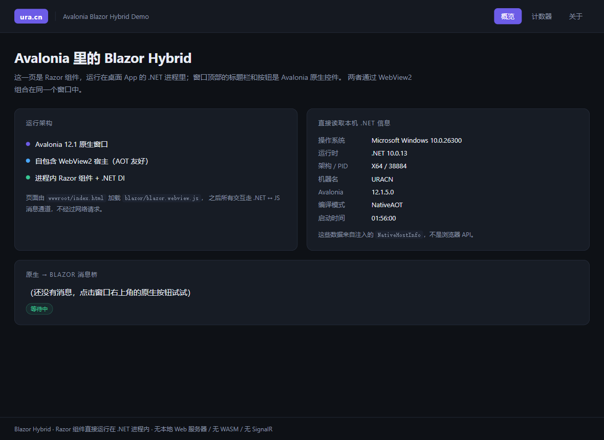
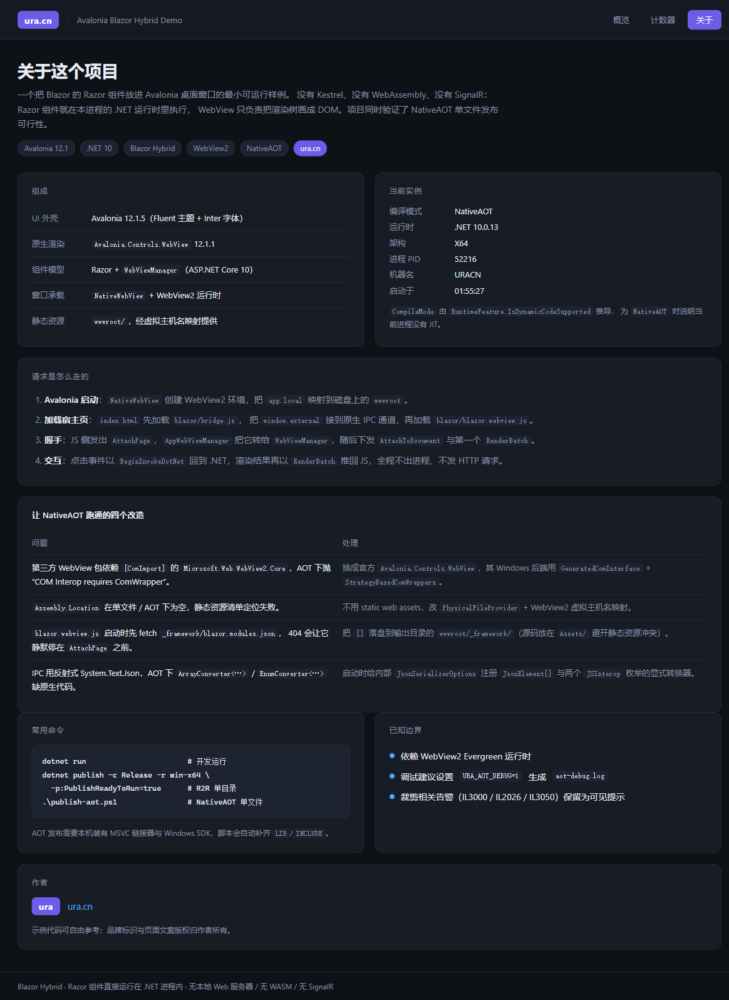

# Avalonia Blazor Hybrid Demo

把 **Blazor 的 Razor 组件**装进 **Avalonia 桌面窗口**的最小可运行样例，并验证 **NativeAOT 单文件发布**可行。

没有 Kestrel、没有 WebAssembly、没有 SignalR：Razor 组件直接运行在桌面进程的 .NET 运行时里，
原生 WebView 只负责把 Blazor 的渲染树画成 DOM。这是真正的 Blazor Hybrid，不是「桌面壳 + 本地网页服务器」。

```
┌──────────────────────────── Avalonia 窗口 ────────────────────────────┐
│  原生标题栏 / 按钮（Avalonia 控件）                                    │
├───────────────────────────────────────────────────────────────────────┤
│  NativeWebView (WebView2)                                             │
│    └── wwwroot/index.html → blazor.webview.js → Blazor 渲染 DOM        │
├───────────────────────────────────────────────────────────────────────┤
│  同一 CLR 进程：Razor 组件 · DI · Renderer · WebViewManager · IPC      │
└───────────────────────────────────────────────────────────────────────┘
```

| 概览（NativeAOT 产物） | 关于 |
| --- | --- |
|  |  |

## 特性

- **Avalonia 12.1.5** 原生窗口（Fluent 主题 + Inter 字体），品牌样式为 `ura.cn`。
- **官方 `Avalonia.Controls.WebView` 12.1.1** 承载 WebView2，Windows 后端基于
  `GeneratedComInterface` + `StrategyBasedComWrappers`，可在 NativeAOT 下工作。
- **官方 Blazor Hybrid 管线**：`WebViewManager` + `IpcCommon` + `blazor.webview.js`，未改动一行框架代码。
- **原生 ↔ 组件双向互通**：
  - `NativeBridge` 静态事件把原生按钮的点击送进 Razor 组件；
  - `NativeHostInfo` 作为 DI 服务把 OS / 运行时 / PID / 编译模式暴露给页面。
- **三种发布形态**：框架依赖运行、ReadyToRun 单目录、NativeAOT 单文件。

## 环境要求

| 项 | 版本 |
| --- | --- |
| .NET SDK | 10.0 |
| Avalonia | 12.1.5 |
| Avalonia.Controls.WebView | 12.1.1 |
| WebView2 Runtime | Evergreen（Win10/11 通常已预装） |
| NativeAOT 额外要求 | MSVC 链接器 + Windows 10/11 SDK（VS 的「使用 C++ 的桌面开发」工作负载） |

## 运行

```powershell
dotnet run
```

窗口右上角的「发送消息到 Blazor」是原生 Avalonia 按钮，点击后消息会出现在「概览」页的消息桥卡片里；
「计数器」页验证 Blazor 的增量渲染与事件回传；「关于」页列出架构、AOT 改造点与常用命令。

## 发布

### ReadyToRun（推荐日常分发）

```powershell
dotnet publish -c Release -r win-x64 -p:PublishReadyToRun=true -o bin/publish-r2r
```

保留 CoreCLR，启动快、兼容性最好，仍是多文件目录。

### NativeAOT（单文件，无 JIT）

```powershell
.\publish-aot.ps1                       # 默认输出 bin/publish-aot
.\publish-aot.ps1 -Output bin\publish-aot-final
```

脚本会自动定位 VS 的 MSVC 与 Windows SDK，补齐 `LIB` / `INCLUDE` / `PATH`，
再执行 `dotnet publish -p:EnableWindowsAot=true -p:IlcUseEnvironmentalTools=true`。
后者让 ILC 直接使用上面设置的环境变量里的 `link.exe`，而不是再去跑 `findvcvarsall.bat`
（在 C++ 工具链已装但未完整注册的机器上，那个脚本会报 "Platform linker not found"）。
产物约 57 MB 的单 exe，运行时依赖同目录的 `wwwroot/`、`libSkiaSharp.dll`、`libHarfBuzzSharp.dll`、`av_libglesv2.dll`。

> AOT 相关开关集中在 `.csproj` 的 `EnableWindowsAot` 条件块里，普通构建完全不受影响。

## 让 NativeAOT 跑通的四个改造

| 问题 | 处理 |
| --- | --- |
| 第三方 WebView 包依赖 `[ComImport]` 的 `Microsoft.Web.WebView2.Core`，AOT 下抛 `COM Interop requires ComWrapper instance registered for marshalling` | 换成官方 `Avalonia.Controls.WebView`，其 COM 走 `GeneratedComInterface` / `StrategyBasedComWrappers` |
| `Assembly.Location` 在单文件 / AOT 下为空，static web assets 清单定位失败（`IL3000`） | 不用 static web assets，改 `PhysicalFileProvider(wwwroot)` + WebView2 `SetVirtualHostNameToFolderMapping` |
| `blazor.webview.js` 启动时先 `fetch("_framework/blazor.modules.json")`，404 会让它在发出 `AttachPage` 前静默失败，页面永远停在「正在启动…」 | 把 `[]` 落盘到输出目录 `wwwroot/_framework/`（源文件放 `Assets/`，避免与包内静态资源同路径冲突） |
| IPC 用反射式 `System.Text.Json`，AOT 下 `ArrayConverter<JsonElement[], JsonElement>`、`EnumConverter<JSCallResultType>` 报「missing native code or metadata」 | 启动时给内部 `JsonSerializerOptionsProvider.Options` 注册显式转换器：`JsonElement[]`、`JSCallResultType`、`JSCallType`（见 `Blazor/IpcJsonWorkaround.cs`） |

另外 `Roots.xml` 作为 `TrimmerRootDescriptor` 保留 Blazor / DI / JS interop / Avalonia 的反射入口，
只在 `EnableWindowsAot=true` 时生效。

## 目录结构

```
AvaloniaBlazorHybridDemo/
├── Program.cs                     # 入口：诊断初始化 + IPC JSON workaround + Avalonia 启动
├── App.axaml(.cs)                 # 应用与 DI 容器（NativeHostInfo / JSComponentConfigurationStore）
├── MainWindow.axaml(.cs)          # 原生外壳、标题栏、原生按钮
├── BlazorWebViewHost.cs           # NativeWebView 宿主 + 虚拟主机名映射（COM vtable）
├── Blazor/
│   ├── AppWebViewManager.cs       # WebViewManager 子类：Navigate / SendMessage / IPC 入口
│   ├── AvaloniaBlazorDispatcher.cs# 把渲染调度到 Avalonia UI 线程
│   └── IpcJsonWorkaround.cs       # NativeAOT 下的 System.Text.Json 兼容层
├── Components/                    # Razor 组件（AppWeb / MainLayout / Home / Counter / About）
├── wwwroot/
│   ├── index.html                 # 承载页
│   ├── css/app.css                # 暗色 UI 与品牌样式
│   └── blazor/
│       ├── bridge.js              # window.external ↔ invokeCSharpAction / __blazorReceive
│       └── blazor.webview.js      # 来自 Microsoft.AspNetCore.Components.WebView 10.0.0
├── Assets/blazor.modules.json     # 复制到输出 wwwroot/_framework/（内容为 []）
├── Roots.xml                      # NativeAOT 裁剪保留描述
└── publish-aot.ps1                # 一键 NativeAOT 发布
```

## 调试

- **AOT 诊断日志**：设置 `URA_AOT_DEBUG=1` 后运行，会在 exe 同目录写 `aot-debug.log`，
  记录启动阶段、虚拟主机映射、每条 `JS->NET` / `NET->JS` 消息、未处理异常。
- **WebView2 DevTools**：设置
  `WEBVIEW2_ADDITIONAL_BROWSER_ARGUMENTS="--remote-debugging-port=9222 --remote-allow-origins=*"`，
  即可用 CDP 连上页面（本目录的验证脚本即用此方式驱动点击与读取 DOM）。
- **裁剪告警**：`IL3000` / `IL2026` / `IL3050` / `IL3053` 目前保留为可见提示，
  它们分别对应 `Assembly.Location`、反射式 JSON 与第三方程序集的 AOT 分析结果。

## 已知限制

- 必须安装 WebView2 Evergreen 运行时；未安装时窗口内会显示启动失败提示。
- NativeAOT 不支持内置 COM，因此不能回退到旧的 `Microsoft.Web.WebView2.Core` 包。
- 页面纹理与 SkiaSharp 原生库仍需随 exe 一起分发，不是严格意义上的「单文件无依赖」。

## 作者

**ura** · <http://ura.cn>
